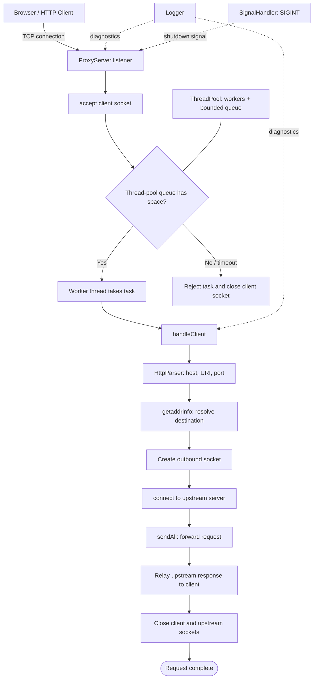
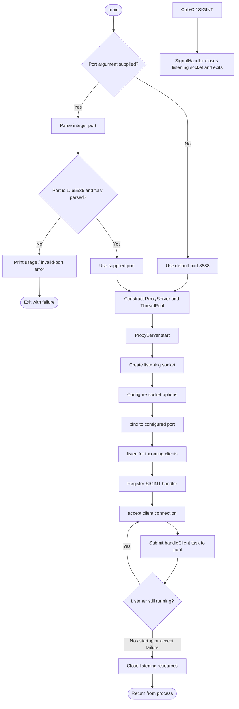
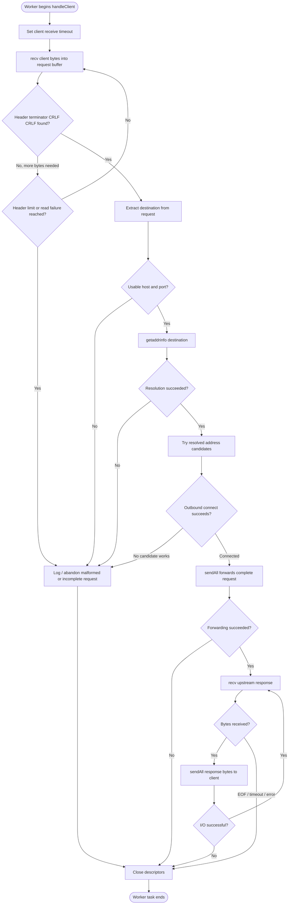
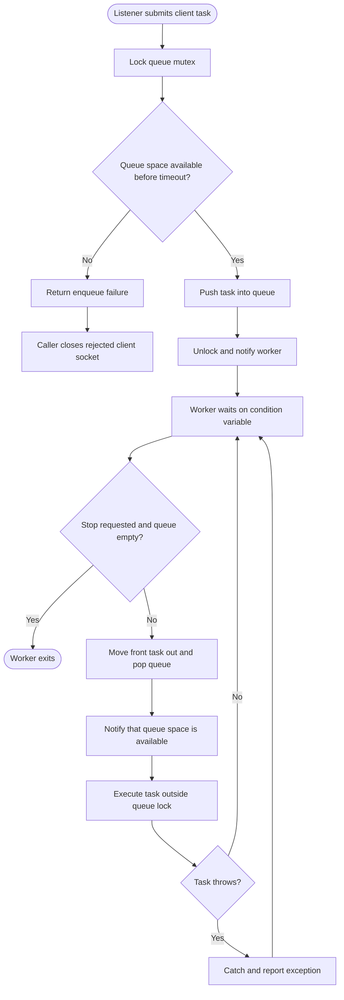
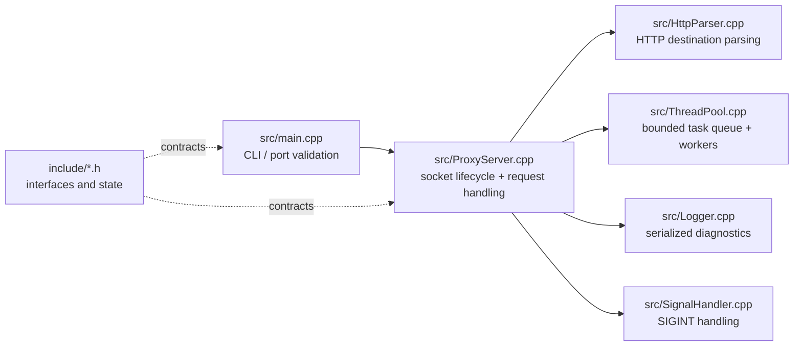

# Project Flowchart — `proxy_server`

These diagrams explain the **implemented control flow**.

## How to read thid
- **Rectangle**: operation / component.
- **Diamond**: decision.
- **Solid arrows**: normal control or data flow.
- The Mermaid diagrams render on GitHub and in VS Code with a Mermaid preview extension.
- Start with each project's **big picture**, then follow the request/transaction flow.

---

# `proxy_server`

## 1. Big-picture architecture

**Mental model:** the listener accepts connections; the pool decides which worker handles each client; a worker parses one HTTP request, connects upstream, forwards bytes, relays the response, and cleans up descriptors.

## 2. Process startup and listener lifecycle

> The default port in this source snapshot is **8888**. The README's architecture diagram describes the general request pipeline; use the code for exact configuration details.

## 3. One client request: end-to-end path

**Key distinction:** `sendAll` handles partial writes and retries `EINTR`; it does not mean the entire HTTP protocol is parsed. The relay is a byte-stream forwarding loop after the request is sent.

## 4. Thread-pool queue and worker lifecycle

**Concurrency idea:** the queue mutex protects queue state; workers release it before running client code, so a slow network request does not hold the queue lock.

## 5. Source-file responsibility map

---

# Suggested reading order

1. `src/main.cpp` — how the program starts and selects the port.
2. `src/ProxyServer.cpp` — listener lifecycle and `handleClient` (the central request path).
3. `src/HttpParser.cpp` — how destination host/port are extracted.
4. `src/ThreadPool.cpp` — how work is queued and executed.
5. `src/SignalHandler.cpp`, then `src/Logger.cpp` — shutdown and diagnostics.

## Important interpretation note
- These are **code-understanding flowcharts**, not a certification that every advertised property is fully correct under every failure mode.
